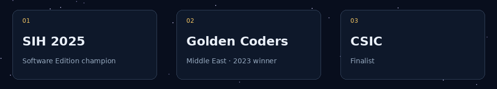
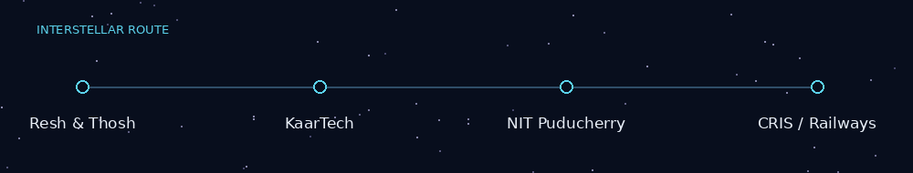

## `01 / About me`

I'm Rahul, a computer science undergraduate at **Chennai Institute of Technology (Class of 2027)**. I enjoy the point where algorithms, research, and good software engineering come together to solve a real problem.

I've worked on everything from offline-first public-service applications to AI workflows and distributed database systems. Competitive programming keeps my problem-solving sharp; building things teaches me what happens beyond the accepted solution.

- **Current interests:** backend engineering, AI/ML, distributed systems and cybersecurity.
- **Off-screen:** painting and playing the keyboard.
- **Open to:** meaningful software engineering collaborations and research projects.

## `02 / Highlights`

- 🏆 **Smart India Hackathon 2025 — Champion**, Software Edition, Team Technical Terminators.
- 🥇 **Golden Coders 2023 — Winner**, Middle East.
- 🚀 **CSIC — Finalist**.
- 🧠 Competitive programmer on [Codeforces](https://codeforces.com/profile/RahulR_), [CodeChef](https://www.codechef.com/users/rdrahul2005), and [LeetCode](https://leetcode.com/u/rahulrnewr/).

## `03 / What I've built`

| Project | Why it matters |
|:--|:--|
| 🏆 **[Nyay Sahayak](https://github.com/rahul14rx/sih_winner_loan)** | SIH-winning loan utilization verification platform with offline capture, AI-assisted checks, and officer review. |
| 🗄️ **[VaultDB](https://github.com/rahul14rx/VaultDB-Distributed-SQL-Engine)** | Exploring the internals of a distributed SQL engine. |
| 🧩 **[OASIS](https://github.com/n1shanthb/OASIS)** | Intelligent workforce allocation and scheduling, developed following my CRIS internship. |
| 🛡️ **[Raksha](https://github.com/rahul14rx/raksha-backend)** | Security log ingestion backend for a CSIC project. |
| 🔐 **[Qumail](https://github.com/rahul14rx/qumail)** | Email client prototype exploring quantum key distribution integration. |
| 🤖 **[AI Blueprint](https://github.com/rahul14rx/ai_blueprint)** | Experimenting with AI-driven application workflows. |

[Explore all repositories →](https://github.com/rahul14rx?tab=repositories)

## `04 / The stack`

## `05 / Experience`

| Where | Work |
|:--|:--|
| **CRIS / Ministry of Railways** · 2026 | Software engineering internship; continued building OASIS afterward. |
| **NIT Puducherry** · 2025 | Research internship on Tamil medical question answering and reinforcement learning. |
| **KaarTech Technologies** · 2025 | Full-stack development for the KEBS Help Center. |
| **Resh and Thosh** | Earlier software development internship. |

## `06 / Developer activity`

### 🐍 Crimson contribution snake

<picture>
  <source media="(prefers-color-scheme: dark)" srcset="https://raw.githubusercontent.com/rahul14rx/rahul14rx/output/github-contribution-grid-snake-dark.svg" />
  <source media="(prefers-color-scheme: light)" srcset="https://raw.githubusercontent.com/rahul14rx/rahul14rx/output/github-contribution-grid-snake.svg" />
  
</picture>

The snake is generated from my actual contribution graph and refreshes automatically.

---

**The best part of building something is finding out what it can become.**

